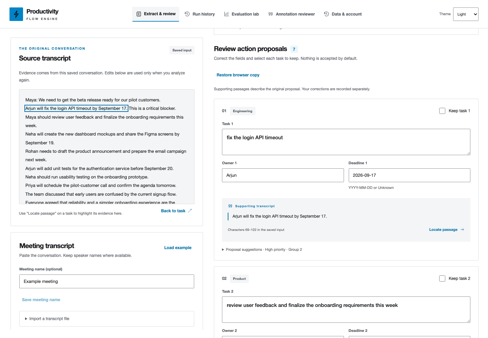

# BriefActions

**A Productivity Flow Engine**

[](https://github.com/sagar-varshney/BriefActions/actions/workflows/ci.yml)

Turn meeting transcripts into action plans you can check, share, and follow through on.
BriefActions finds proposed tasks, owners, and deadlines, and links each suggestion
to the words that support it. You review the details before confirming a plan.
Missing owners and dates stay **Unknown**.

[Get started locally](#run-locally) · [User guide](docs/user-guide.md) · [Deployment](docs/deployment.md) · [Evaluation](evaluation/README.md)



Screenshots use synthetic example conversations.
[Homepage](docs/screenshots/homepage.png) · [Dark mode](docs/screenshots/review-dark.png) · [All tasks](docs/screenshots/all-tasks-light.png) · [Plan changes](docs/screenshots/plan-changes-light.png) · [Sign-in](docs/screenshots/sign-in-light.png)

## How it works

1. **Bring a transcript.** Paste your conversation, import a TXT/VTT/SRT file, or
   try the built-in example. Set the meeting date so relative deadlines make sense.
2. **Check the suggestions.** Inspect supporting passages, correct details, add a
   missed action, and select the tasks you want to keep.
3. **Confirm your plan.** Copy it or download Markdown or CSV, then track progress
   across meetings in **All tasks**.

Extraction uses rules running on the application's Python backend. The everyday
workflow does not send transcripts to an external language-model API. Optional
model experiments are separate, explicit developer tools.

## What you can do

| Feature | What it helps you do |
| --- | --- |
| Evidence beside every proposal | Jump to the original words, then return to the task you were reviewing. |
| Review before confirmation | Edit tasks, owners, and deadlines; reject suggestions or add an evidence-backed action. |
| Repeated and changed commitments | Merge compatible repeats and inspect evidence for supported deadline revisions or cancellations. Ambiguous references still need review. |
| Follow-up plan review | Compare Added, Changed, Cancelled, and Unchanged tasks; approve a new version while preserving the previous plan. |
| Flexible review layouts | Choose compact rows, detailed cards, or one task at a time; adjust the transcript panel on desktop. |
| Autosaved work | Recover unfinished inputs and reviews after a reload, with explicit recovery for interrupted analyses. |
| All tasks | Search confirmed work by task, owner, or meeting; filter by progress, Today, Overdue, Upcoming, or Unassigned. |
| Calendar | Browse meeting dates and current task deadlines in a month view or mobile agenda; inspect the original plan and find undated work in Unscheduled. |
| Task progress | Move work through To do, In progress, and Done without rewriting the confirmed plan or its evidence. |
| Searchable meeting history | Name meetings, filter by date or review status, and inspect the activity behind a saved plan. |
| Shareable plans | Copy a plan, download Markdown or CSV, or export the complete saved history. |
| Guided onboarding | Use optional walkthroughs, plain-language explanations, and a glossary. Research tools are separate from everyday work. |

**A public introduction, then your workspace.** The homepage includes an interactive
sample and a mix of light and dark sections. A separate sign-in page leads to the
private tool. Hosted deployments support GitHub sign-in through Supabase, with
email links available when configured.

**Choose your appearance.** Sign-in and the workspace offer Light, Dark, and System
themes, with blue-to-cyan accents and responsive layouts. Keyboard navigation,
visible focus, and automated accessibility checks cover both themes; manual
screen-reader and usability checks remain part of launch verification.

## Run locally

Use **Node.js 24+**, **pnpm 11.25.0**, and **Python 3.10+**. CI uses Python 3.13.
Install the pinned package manager with `npm install --global pnpm@11.25.0` if needed.

```bash
git clone https://github.com/sagar-varshney/BriefActions.git
cd BriefActions
python3 -m venv .venv
source .venv/bin/activate
python -m pip install -r requirements.txt
pnpm install --frozen-lockfile
pnpm dev
```

On Windows, activate the environment with `.venv\Scripts\Activate.ps1` in PowerShell
instead of the `source` command.

Open **[http://127.0.0.1:5173](http://127.0.0.1:5173)**, choose **Get started**, then
**Open local workspace**. No account or hosted credentials are needed locally.
`pnpm dev` starts React and the API together; Vite proxies `/api` to port 3001.

Local history uses the ignored `data/history.sqlite3` database. The server prefers
`.venv/bin/python3`, then falls back to `python3`; set `PYTHON_BIN` to choose another
interpreter. For a built local preview, run `pnpm build`, then `pnpm start`, and
open **http://127.0.0.1:3001**.

The included `.env.example` is a **hosted production template**. Local development
does not require copying it. See the [developer guide](docs/development.md) for
runtime settings, architecture, API routes, and verification commands.

## Your data and saved work

- **Account separation:** hosted deployments use Supabase authentication and
  account-scoped Postgres storage. A private meeting link still requires its
  owner's account.
- **Traceable decisions:** original inputs, proposals, corrections, confirmations,
  and progress are retained. Confirmed plans remain fixed; progress is tracked separately.
- **Draft recovery:** input drafts stay in your browser, scoped by account and tab.
  Saved review drafts also reach the server. Browser-only drafts do not sync to
  other devices and are excluded from workspace exports.
- **Export and deletion:** Data & account provides a complete workspace export,
  transcript erasure, storage usage, and hosted account deletion. Downloads and
  old backups remain separate copies.
- **Reliable retries:** interrupted analyses and progress updates reuse request IDs;
  stale edits are rejected instead of silently replacing newer work.

The app includes a public **Privacy & data** page explaining storage and access.
[Backup and recovery instructions](docs/backups.md) cover encrypted application
backups and erasure-aware restoration. Scheduled backups require operator setup.

## Check and improve extraction quality

Optional **Research tools** help you label examples and compare extraction methods:

- **Label & review examples:** highlight supporting passages, label tasks, owners,
  and dates, collect separate reviews, and resolve disagreements before freezing
  an evaluation set. Real transcripts require permission and a checked anonymization preview.
- **Compare extraction methods:** inspect saved rule/model results or explicitly
  compare original and current rules against your frozen reviewed examples.
- **Repeat model experiments:** use the CLI to compare installed Ollama models and
  prompt versions, retaining quality, latency, API fees, failures, and run fingerprints.

The repository includes **84 synthetic annotated transcripts**: a 60-case starter
set and 24 revision/cancellation cases, each split into development and reserved
test examples. The annotations were AI-authored and have **not been independently
human-reviewed**. No permitted real-meeting transcripts are included. These scores
do not establish real-meeting accuracy. Task matching is lexical, and passage
support is an annotated-span proxy rather than a semantic entailment check.

See the [evaluation methodology](evaluation/README.md),
[retained rule/model results](evaluation/results/COMPARISON.md), and
[repeated model comparison](evaluation/results/repeated-revision-dev/COMPARISON.md).
Fresh independently reviewed data is needed before making broader accuracy claims.

## Deploying BriefActions

A [Dockerfile](Dockerfile), [Render Blueprint](render.yaml), Supabase configuration,
and ordered [database migrations](deploy/migrations/) are included. The React app
and Node API share one origin; Python runs extraction, and Postgres stores account data.

**Deployment configuration is included; a public hosted instance has not been
launched.** Launch requires your hosting project, Supabase credentials, OAuth
redirects, migrations, and live verification. Production refuses to start without
authentication, persistent database configuration, and an HTTPS public origin.

Follow the [deployment guide](docs/deployment.md), configure
[backups](docs/backups.md), then complete the [launch checklist](docs/launch-checks.md).
Local history is not automatically uploaded when you deploy.

## Development and checks

With the local setup complete:

```bash
python -m unittest discover -s tests -v
pnpm test
pnpm build
pnpm exec playwright install chromium
pnpm test:browser
```

[GitHub Actions](https://github.com/sagar-varshney/BriefActions/actions/workflows/ci.yml)
also checks real Postgres account isolation, encrypted backup/restore, development
extraction quality, and the production Docker image under a constrained resource
profile. CI does not rerun held-out scoring or make real model calls.
See [development and verification](docs/development.md) for benchmark commands
and environment settings.

## Documentation

| Guide | Contents |
| --- | --- |
| [Using BriefActions](docs/user-guide.md) | Transcripts, review, task tracking, exports, and research tools in plain language |
| [Development](docs/development.md) | Architecture, API reference, local settings, tests, and CI |
| [Evaluation](evaluation/README.md) | Annotation policy, scoring, prompts, model experiments, and limitations |
| [Deployment](docs/deployment.md) | Hosting, authentication, database setup, and production configuration |
| [Backups](docs/backups.md) | Encrypted snapshots, scheduling, and recovery drills |
| [Launch checks](docs/launch-checks.md) | Operational checks and live account verification |
| [Usability feedback](docs/usability-check.md) | First-user walkthrough and manual feedback checklist |

The repository also preserves a separate legacy FastAPI/RAG backend in `app/`.
It is not connected to the BriefActions interface; see its [own guide](docs/rag-backend.md).
