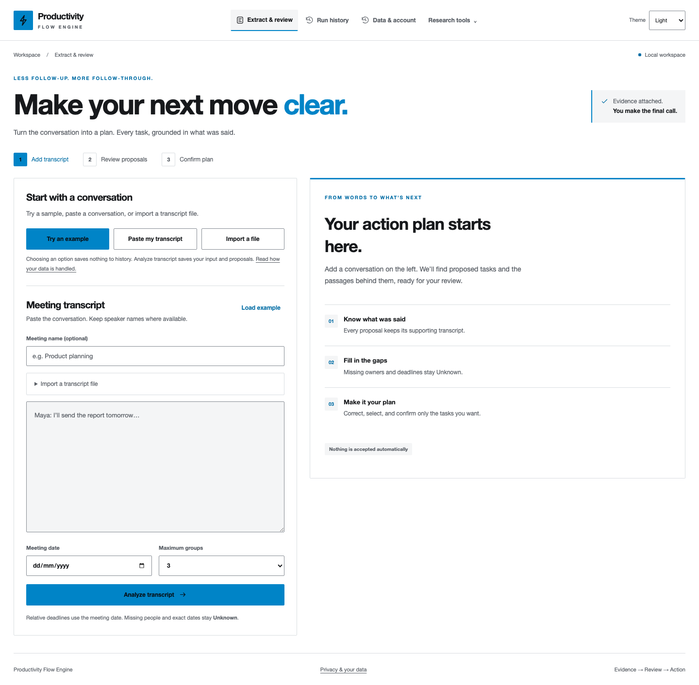
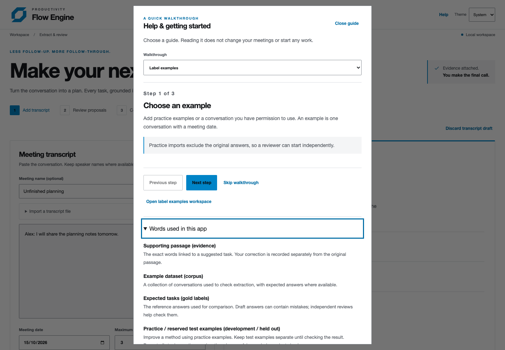
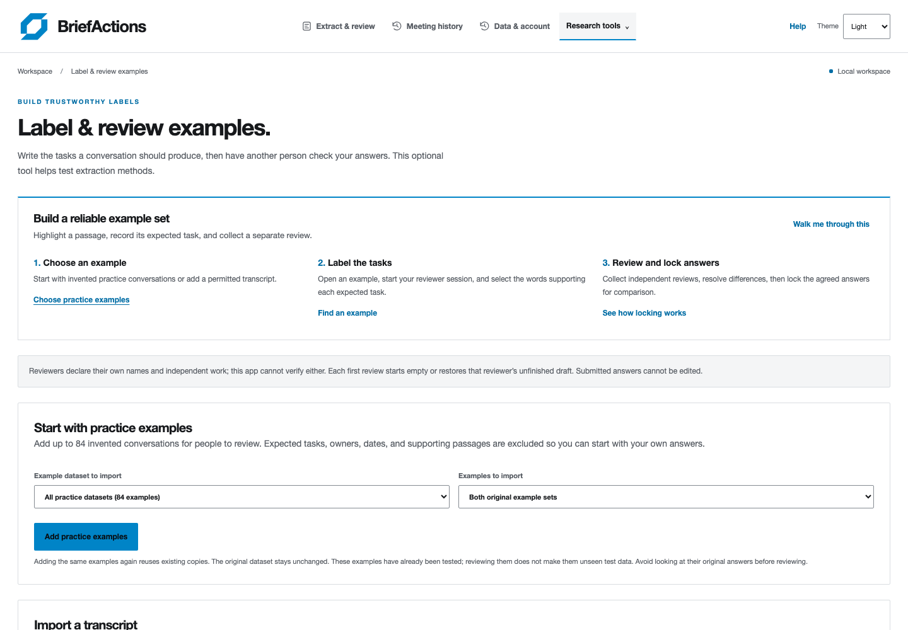
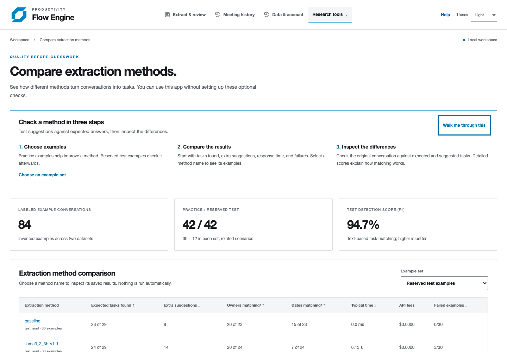

# BriefActions

**A Productivity Flow Engine**

[](https://github.com/sagar-varshney/BriefActions/actions/workflows/ci.yml)

Turn meeting transcripts into clear action plans, with tasks, owners, deadlines,
and supporting evidence. Review and correct each proposal before confirming your plan.

Built with React and Node.js, BriefActions preserves the complete review history.
Extraction quality is measured against an annotated evaluation set.



[Public homepage](docs/screenshots/homepage-light.png) · [Review workspace](docs/screenshots/review-light.png) · [Dark theme](docs/screenshots/review-dark.png) · [Task progress](docs/screenshots/task-progress-light.png) · [Sign-in page](docs/screenshots/sign-in-light.png)

## Review with context

Review suggested tasks alongside the original transcript. Use **Locate passage**
to check the supporting words, correct details, and choose which tasks to keep.
Missing owners and deadlines stay **Unknown** until you supply them.

The workspace supports light, dark, and system themes, keyboard navigation, and
mobile layouts. Screenshots use synthetic demo inputs.

## From reviewed plans to daily work

**All tasks** brings confirmed tasks from your meetings into one private dashboard.
Search by task, owner, or meeting name; filter by progress, Today, Overdue,
Upcoming (the next seven days), or Unassigned. Open a result to go directly to its
task and supporting transcript. Date views use your device's date and exclude
completed tasks. Counts follow the current search and progress filter.

Confirmed plans offer **Copy action plan** and **Download Markdown**, grouped by
owner, deadline, or original task order. Both include the complete confirmed plan
and its supporting passages, preserving Unknown values. Progress updates do not
rewrite these exports. A preview lets you copy manually when clipboard access is
unavailable. CSV and full history downloads remain available.

During review, **What to check** explains missing details, invalid dates, and
proposals with matching task wording but different deadlines. Compare the linked
passages before choosing what to keep. These are review aids; Unknown metadata
is allowed, and suggestions never merge or change your decisions automatically.

[All tasks dashboard](docs/screenshots/all-tasks-light.png) · [Dark theme](docs/screenshots/all-tasks-dark.png)

## Guides for first-time users

**Help** is available throughout the signed-in workspace (and local development).
Fresh meetings also offer **Start a quick walkthrough**. The optional guide has
three paths: meeting tasks, labeling examples, and comparing extraction methods.
You can skip, close with Escape, reopen, move backwards, and finish at any time.
Reading a guide never imports examples, analyzes a transcript, submits a review,
or confirms tasks. The native dialog contains keyboard focus and returns it to the
opening control. A glossary explains expected tasks, reserved test examples,
instructions versions, detection score, timing, and approximate passage matching.

The optional research screens use **Label & review examples** and **Compare
extraction methods**. Three-step overviews explain each job and link to relevant
controls. Opening an example moves focus to its heading; starting a review focuses
the read-only conversation for keyboard text selection. Missing metadata remains
Unknown, reviews must be submitted before comparison, and separate identities do
not prove independent human review. Those rules are unchanged.

Comparison tables lead with counts: expected tasks found, extra suggestions,
owner/date matches, response time, fees, and failures. **Detailed scores & how to
read them** retains the percentage metrics and definitions. Counts use the saved
report, with no new scoring or reruns. Extra suggestions did not match a reference task; they are not automatically
unsupported claims. Zero denominators show Not applicable;
missing fees show Unknown. Technical records and downloads preserve original fields.

See the [plain-language user guide](docs/user-guide.md). Automated checks cover the
guides and both-theme keyboard/mobile access; new-user human sessions are still
pending using the [feedback checklist](docs/usability-check.md).

<details>
<summary>Walkthrough and quality-tool screenshots</summary>





</details>

## A simpler everyday workflow

A saved meeting replaces the welcome headline with its own name and a compact
summary strip, so tasks are visible higher on the screen. Completing analysis moves
keyboard focus directly to the task review. **Edit meeting** opens the input editor;
it starts collapsed after analysis or loading a saved meeting. Closing it preserves
transcript edits, review corrections, and selections. If the input differs from the
saved conversation, a visible notice links to **Review changes**. Editing alone
never replaces the original evidence or reruns analysis.

The original source remains open by default on desktop. On narrower screens it
starts collapsed; **Locate passage** opens it, highlights the exact text, and moves
focus there. **Back to task** returns to the originating control. The source can
also be opened or closed with its summary using the keyboard. The editor and source
are separate controls, so users can inspect evidence without reopening input setup.

Navigation uses **Meeting history**, saved records open with **Open meeting**, and
the readable timeline is labeled **Activity**. Repeated explanatory copy is kept
under **Review help** and **About task progress**. Research tools, technical
fingerprints, and complete JSON exports remain accessible when needed.

These workflows have automated browser and accessibility checks; first-time human
usability sessions have not been conducted by the agent. A short
[first-user feedback checklist](docs/usability-check.md) is ready for those sessions.

## Faster review and task follow-through

**Show proposals** filters the current meeting to all proposals, selected items,
or items that need attention. **Select visible** and **Clear visible selection**
change only the rows currently shown; in the single-task layout they affect just
that task. Filtering never clears edits or selects tasks automatically. Confirmation
always includes all selected proposals, with an explicit count and a warning when
selected tasks are outside the current view. Invalid fields are revealed and focused
before confirmation, even when the offending proposal was filtered out.

Choose **Compact rows**, **Detailed cards**, or **Focus one task** under **Review
layout**. Compact rows expand for editing and evidence; focus mode keeps edits and
selections while moving between tasks. Desktop defaults to detailed cards; a fresh
mobile workspace defaults to focus mode. The layout preference is account-scoped
in this browser. Attention shortcuts jump to missing owners, missing dates, empty
tasks, or invalid dates. Unknown metadata is allowed; the app does not invent it.

Under desktop **Layout options**, **Transcript panel width** adjusts the real columns from 32% to 55%, with
keyboard support, a saved browser preference, and **Reset layout**. Narrow screens
stack the panels. Changing review views clears a previous evidence highlight so
**Back to task** never points to a hidden or removed control. **Meeting details**
below the tasks contains the meeting summary and nested **Technical details**;
**Review help** contains supporting guidance and browser-copy recovery.

Confirmed tasks have separate **To do**, **In progress**, and **Done** states.
Filter the current meeting's tasks by status, overdue, due today, next seven days,
or unknown dates. Date filters use the device's calendar date; overdue, due-today,
and upcoming views exclude completed tasks. Progress never edits the confirmed
plan, its evidence, or its CSV. Updates append versioned `task_progress` events,
which are included in history, complete workspace exports, deletion, and encrypted
backups. No new database migration is required. Stale writes return a conflict;
**Refresh task progress** retrieves the current state. Interrupted updates retain
a stable request ID in account-scoped browser storage and can be retried after
reload without duplicating an update or rolling newer progress back.

History now shows a readable activity timeline with before/after corrections,
selections, confirmations, meeting renames, and progress changes. Conversation
revisions and cancellations display their supporting passages. Raw event JSON and
the complete history download remain available. The timeline shows the latest 30
events initially, with **Show earlier activity** for older entries; review autosaves
appear when the run is next loaded or confirmed.

## Navigation and meeting links

Every meeting has a private `/meetings/:id` URL. Sections use `/meetings`, `/history`,
`/account`, `/research/evaluation`, and `/research/annotations`. Refresh and browser
Back/Forward preserve the section or load the requested meeting. The old `/#data`
link still opens account settings. Opening `/meetings` starts or restores that tab's
new-meeting draft. `/` is the public homepage, with an interactive sample plan,
workflow introduction, features, and common questions. **Sign in** opens `/sign-in`;
successful hosted sign-in opens the private workspace. Existing sessions can use
**Open workspace** from the homepage. Unsaved transcript
protection and interrupted-analysis recovery still apply when opening another run.

A task link adds `?task=<proposal-id>` to its meeting URL, opens the exact confirmed
task, and keeps its supporting passage accessible. **All tasks** uses `/tasks`.

Every saved meeting request requires the signed-in account; knowing a URL does not
grant another account access. The sign-in flow can retain a requested destination
through the same tab's session storage, including its task selection. Only known,
same-origin workspace routes are accepted as return destinations. `/auth/callback`
completes GitHub or email-link sign-in; older callbacks to `/` remain supported.
Signing out clears the return destination and opens `/sign-in`. The primary navigation keeps extraction,
history, and account controls visible; **Research tools** contains Compare extraction methods
and Label & review examples. These research screens remain available to each account. Research links use left-aligned rows in an anchored desktop dropdown; on phones, they expand within the navigation so account and Help controls stay unobstructed.

## Public deployment and themes

The interface includes Light, Dark, and System themes, with a persistent preference.
The public deployment uses Supabase sign-in and persistent Postgres storage with
account isolation. Browser drafts are scoped per account, and CSV/JSON exports
are authenticated. Local development continues to use SQLite on loopback.

Use the included Dockerfile and Render Blueprint for **Render + Supabase**.
See [deployment setup, provider limits, and launch verification](docs/deployment.md).
Hosting credentials and live OAuth configuration must be supplied before launch;
the production server refuses an unprotected or ephemeral storage configuration.
Benchmark provenance and metric limitations are documented in the evaluation section below.

## Getting started and privacy

Fresh workspaces start with an empty transcript and meeting date. Choose **Try an
example**, **Paste my transcript**, or **Import a file**. The example is labeled as
synthetic and loading it does not save a run. **Analyze transcript** saves the
approved input and proposals; existing unfinished reviews and interrupted analyses
still restore before the welcome choices appear. Example inputs also autosave in
the browser; **Discard transcript draft** returns a fresh workspace to empty inputs.

The public `/privacy` page is available before
sign-in, without requesting private APIs. It explains stored inputs, browser
copies, service-operator access, exports, deletion, operational logs, and separate
backup retention. Sign-in and workspace footers link to it. Operators should keep
this explanation aligned with their actual deployment and backup configuration.

**Data & account → Workspace storage** shows UTF-8 payload bytes separately for
saved history and current annotation drafts, with a refresh button. Hosted limits
match the existing database enforcement: **25 MB history / 5 MB annotation drafts
per account** (decimal MB). At 80% usage, the app suggests exporting and deleting
saved inputs. History includes every saved review version and evaluation, so usage
is not just transcript size. Local SQLite shows measured usage without claiming
to enforce hosted quotas. Browser copies, exported files, backups, database row
metadata, and physical database overhead are excluded. Deletion frees measured
space; limits and usage are always scoped by the verified account.

## Transcript drafts and searchable meetings

Transcript text, meeting name, date, and grouping settings autosave in this
browser as you edit, before analysis. Drafts are separated by account, tab, and
saved run. Reloading restores that tab's inputs without overwriting proposal
review edits. **New meeting** parks the current run and resumes that tab's separate
new-meeting draft, or starts empty. Opening a saved run keeps a new-meeting draft
available for later. **Discard transcript draft** clears the current browser copy
and restores the saved input, or empties a new meeting. Successful analysis clears
the matching input draft; unfinished analysis requests retain their existing
explicit retry flow. If browser storage fails, the app warns and prevents opening
another run over the unsaved text.

These drafts do not upload transcript edits before analysis and are excluded from
workspace exports and server storage meters. They are not cross-device sync:
a fresh tab has a separate draft, and browser storage clearing removes them.
Input/account erasure clears matching browser copies and open tabs. The privacy
page documents this behavior.

Name a new meeting before analysis, or use **Save meeting name** on an existing
run. Names accept up to 120 characters on one line. Renaming appends an audited,
versioned event; original extraction and confirmed tasks remain unchanged. A
conflicting name change in another tab is rejected; reopen the run to review it.
Legacy unnamed runs display their meeting date without requiring a migration.
Names survive workspace export and encrypted backup/restore.

**Meeting history** searches current meeting names and original transcript text,
with case-insensitive literal matching (percent signs and underscores are not
wildcards). Filter by meeting date range and Awaiting review/Confirmed status.
The private server endpoint returns twelve meetings per UI page, newest first,
and never returns another account's matches or totals. An obsolete response is
ignored when filters change. Empty results and invalid date ranges have explicit
messages. Searches do not include later task corrections, annotation cases, or
older meeting names; those remain in their respective audit/history views.

## Data controls and interrupted analyses

**Data & account** downloads a complete workspace JSONL export and lets users
permanently erase extraction or annotation inputs after typed confirmation.
Erasing an extraction removes its transcript, draft, review decisions, and plan.
Erasing an annotation also removes frozen snapshots and comparison reports that
contain it. Other inputs remain available. Local browser copies for erased inputs
are cleared, and other open tabs reload. Downloaded files and old backups remain
separate copies.

Hosted users can delete their workspace and Supabase sign-in account themselves.
Configure server-only `SUPABASE_SECRET_KEY` and apply migration `002_data_controls.sql`
after `001_accounts.sql`. If the auth provider fails, workspace data stays erased
and the account is paused; **Retry account deletion** finishes the operation.

Each analysis uses a stable request ID. If a response is lost, the interface checks
for the saved result. Unfinished input and its ID survive reloads; **Retry saved
analysis** reuses the same request and cannot create a duplicate run. Reusing an ID
with different input is rejected. Deleted requests cannot recreate erased data.
Save a new analysis when you intentionally want another run.

## Transcript files, accessibility, and recovery

Use **Import a transcript file** on Extract & review or Label & review examples to choose `.txt`, `.vtt`, or
`.srt` files up to 1 MiB. Files are parsed in your browser; caption timestamps,
metadata, and styling are removed while available voice names are retained.
Review/edit the preview, choose **Use this transcript**, then set the actual
meeting date and analyze (or review permission/anonymization before importing for annotation). Selecting a file does not save or analyze it. Supporting
passages refer to the exact approved text. UTF-8 and BOM-marked UTF-16 are supported;
empty, malformed, or oversized inputs show a clear error. Repeated caption text
is preserved for the extractor to interpret conservatively.

Both themes have stronger text/control contrast and visible keyboard focus. A skip
link reaches the main workspace, keyboard navigation focuses the new page heading,
and comparison tables can be scrolled with the keyboard. Confirmation dialogs trap
focus, start on Cancel, support Escape, and restore focus. CI runs axe accessibility
checks across all five pages, import previews, sign-in and dialogs in both themes,
plus keyboard checks and 320px reflow. Automated scans are not a full WCAG audit;
screen-reader and user testing remain part of launch verification.

Encrypted application backups and an empty-database restore tool are included.
Apply `003_backup_metadata.sql`, configure the GitHub Actions backup secrets/variable,
and test a restore before enabling scheduled backups. A fresh erasure ledger
prevents the restore from reintroducing later transcript/account deletions known to
that ledger. Scheduling is inactive until configured; provider Auth and hosting
configuration need separate recovery procedures. See [backup setup and recovery](docs/backups.md).

## Launch reliability

Production defaults to one analysis worker to bound memory use on a small host.
Traffic limits belong to verified accounts, so users sharing a hosting proxy do
not share a quota. Token rotation and forwarding headers cannot reset an account's
limits. Provider checks, worker concurrency, and queues stay bounded.

Errors include a reference code. Structured host logs record status, duration,
fixed route names, and safe error categories; they exclude transcript content,
credentials, account IDs, raw URLs, and exception text. Runtime counters include
latency buckets, worker/queue use, and container memory where available.

Render/Docker use `/api/live` for fast process health; `/api/health` independently
checks runtime and storage readiness. CI exercises the production container with
512 MiB and 0.1 CPU using synthetic concurrent analyses, explicit retries, local
HTTPS auth fixtures, Postgres storage, evidence/isolation checks, and OOM detection.
See [operational logs, resource tests, and final live verification](docs/launch-checks.md).

## Run locally

Use **Node.js 24+** and **pnpm 11+**, plus Python 3.10+ for the retained
extraction engine. React handles the interface; a Node HTTP API calls the Python
engine through a bounded JSON subprocess protocol. The extractor, annotated
evaluation set, prompts, and measured reports are unchanged. Local SQLite storage
adds erasure markers and account lifecycle tables automatically; existing runs
remain readable.


```bash
python3 -m venv .venv
source .venv/bin/activate
pip install -r requirements.txt
pnpm install
pnpm dev
```

Open **http://127.0.0.1:5173** for the public homepage, then use **Get started**
and **Open local workspace** to preview the flow. Local development requires no
account; public deployments require authenticated accounts. The workspace is at
`/meetings`. The development API runs on port 3001;
Vite proxies `/api` requests to it. `pnpm dev` starts and stops both processes.
The loaded example uses its original meeting date (2026-09-15); set the actual
meeting date when pasting a new transcript.

For a built local app, run `pnpm build` then `pnpm start` and open
**http://127.0.0.1:3001**. `PORT=8765 pnpm start` changes the API/app port.
`PYTHON_BIN=/absolute/path/to/python3 pnpm dev` selects another interpreter;
otherwise `.venv/bin/python3` is preferred, with `python3` as fallback.
The macOS `run_local_4h.sh` helper now builds and serves this React application.
On this machine, **`./run_local.sh`** also starts development without adding tools
to your shell profile: the launchers reuse Codex's bundled Node/pnpm if installed
commands are unavailable. Python requirements must still be installed.

Paste a transcript, set its meeting date, and select **Analyze transcript**.
Inspect the exact supporting passages, edit tasks/owners/deadlines, select the
items to keep, and choose **Confirm selected tasks**. CSV export becomes available
for the confirmed plan. If an action is missing, use **Add a missed action**, highlight
the saved transcript, and enter task/owner/deadline fields (Unknown where absent).
The action is saved as a separate unchecked user-added proposal, while the original
extraction remains intact. Corrections, acceptance/rejection, and original passages
are retained; CSV identifies user-added tasks with `source=manual`. Duplicate actions
with compatible metadata are rejected; edit the existing proposal instead. Confirmed
plans cannot receive additions. Network retries reuse a stable request ID.
Confirmation saves a local plan; external task-system
integration is not implemented.

Missing owners and exact deadlines are explicitly `Unknown`. Vague timing stays
in the task wording. Every proposal includes character spans into the saved
transcript. Repeated tasks with compatible metadata are merged conservatively;
conflicting owners/dates remain separate for review. Broad semantic paraphrase
merging remains limited. Explicit deadline revisions and cancellations resolve only
unique named actions or immediate same-speaker references; ambiguous references
are recorded for review. Supporting original and revision passages are retained.

## Evaluation comes first

The retained starter corpus has **60 manually annotated synthetic transcripts**,
with 30 development and 30 held-out examples. Annotations are authored by Codex
and have not been independently reviewed. Related scenarios occur in both splits;
these measurements do not establish real-meeting or production accuracy.

Rules were improved on development cases, then frozen before held-out scoring.
On the held-out synthetic set:

| Metric | Original rules | Improved rules |
| --- | ---: | ---: |
| Task precision | 74.2% | 96.4% |
| Task recall | 79.3% | 93.1% |
| Task F1 | 76.7% | 94.7% |
| Owner accuracy on matched tasks | 87.0% | 100.0% |
| Deadline accuracy on matched tasks | 65.2% | 96.3% |
| Known-deadline end-to-end accuracy | 31.6% | 84.2% |
| Gold support proxy | 45.2% | 92.9% |

Task matching is lexical. Gold support checks task matching, exact gold metadata
and annotated evidence spans; it is not an entailment judge. Full counts,
per-transcript predictions, matches/misses, latency and reproducibility hashes
are retained under `evaluation/results/`.

Read [the retained model/rule comparison](evaluation/results/COMPARISON.md) and
[the annotation policy, scoring definitions and LLM comparison guide](evaluation/README.md).
The next evaluation milestone is independently annotated real meeting transcripts
and a fresh held-out split before further tuning from current test errors.

## Annotation review and fresh evaluation data

Open **Label & review examples** to import synthetic material or real transcripts you have
permission to use. Literal `original => alias` replacements are applied in the browser;
inspect the preview and confirm permission and a manual privacy check. Only the
preview reaches SQLite. There is no automatic guarantee that all identifiers are removed.

Select a case, enter your reviewer identity, and choose **Start or resume review**.
Select passages in the read-only transcript, add task/owner/deadline labels, and attach
additional passages for revisions. `Unknown` is explicit; evidence uses Unicode code-point
offsets. A reviewer starts with empty labels or resumes only their own draft. Unfinished labels,
selected passages, task/owner/deadline fields, and resolution notes save immediately
in browser storage, then to SQLite after a debounce. Drafts are isolated by case,
normalized reviewer identity, and review/resolution mode. Navigation and reload
restore the last reviewer session; independence must be attested again before submission.
Incomplete or invalid dates stay in the draft until corrected. Submitted reviews are
immutable and their drafts are cleared atomically; late autosaves cannot recreate them.
Stale writes from another tab are rejected, with the browser copy retained for explicit recovery. After submission, compare labels; disagreements are recorded and require
a resolution with an explanation before export. Reviewer identities are self-reported
on this local app, not authenticated, and the app cannot verify human independence.

Use **Start with practice examples** to import all 84 bundled synthetic
transcripts, one corpus version, or an original split. Imports verify manifest hashes
and copy only transcript/date/source identifiers. Gold items and annotation rationale
are never copied into annotation storage or first-pass forms. Repeating an import
reuses cases by source ID or matching transcript and date. Filter/search cases by
corpus, original split, or text; the list is paginated. Imported source provenance
is retained in reviewed exports. The existing corpus files and reports stay unchanged.
Reviewing already evaluated cases does not make them unseen held-out data; reviewers
should avoid inspecting their original labels in the Compare extraction methods. Reviewer identity
and independence remain self-attested, not authenticated access control.

Freeze agreed/resolved cases into seeded source-group splits; related meetings/scenarios
must use the same source group. Bundled inputs conservatively share one source group
per corpus version. Complete the reviews for all cases in a selected group before
freezing it, so unfinished members cannot later cross splits. Download dev/test JSONL, their hash manifest, or a
complete snapshot. Frozen cases cannot be relabeled. Existing snapshot IDs reload exports.
Use a fresh source group and a new snapshot for later evaluation rounds. Do not tune
on a held-out snapshot after inspecting its results.

No real transcripts were supplied for this update. **Revision v1 adds 24 manually
annotated synthetic transcripts**, with 12 development / 12 held-out cases, varied
meeting dates, leap/year boundaries, cancellation, ambiguous references, and deadline
changes. Labels were written before benchmark execution and were not independently
reviewed. Related linguistic patterns occur across splits; this is scenario validation,
not a blinded estimate of real-meeting accuracy. The 60-case starter corpus and its
retained reports remain unchanged. See [the new corpus manifest](evaluation/revision-v1/manifest.json).

Repeat development comparisons without overwriting retained reports:

```bash
python3 compare_models.py --config evaluation/repeated-local-models.json \
  --dataset evaluation/revision-v1/dev.jsonl --split dev \
  --output-dir evaluation/experiments/my-repeat-run
python3 compare_models.py --summarize-only --output-dir evaluation/experiments/my-repeat-run
```

Ollama must already be running with the configured models installed. Each pass retains
raw output, usage, actual model ID, code/prompt/data hashes, latency, cost and failures.
Fixed temperature 0 / seed 42 measure repeatability under those settings, not quality
across random seeds. Local API fees are zero; hardware/electricity costs are excluded.
Mean ± sample standard deviation is descriptive, not a confidence interval. Latency
includes adapter/startup/model-load time. Original and new corpus results are filtered
by dataset hash in the Compare extraction methods so same-named JSONL files cannot be mixed.

## Benchmark frozen reviewed snapshots

Open **Compare extraction methods → Compare your reviewed examples** after freezing agreed or
resolved labels in Label & review examples. Select a snapshot and run the original
and current rules on the same inputs. **Development** is the default; scoring
held-out cases or both splits requires an explicit acknowledgment. Viewing test
errors makes them unsuitable for further tuning; prepare a new snapshot for later
validation. Previously evaluated bundled cases are identified and remain previously seen.

The comparison shows detection precision/recall/F1, owner/date accuracy on matched
actions, known-metadata end-to-end accuracy, exact-span validity, annotated support
proxy, latency, and failures. Inspect each transcript's frozen labels versus output,
including missed actions, extra predictions, wrong owners/dates and supporting spans.
Task matching is lexical and support is an annotated-span proxy, not semantic entailment.
Undefined metrics display Unknown. Reviewer identities and independence are self-attested.

Each comparison is saved locally in SQLite with the scored cases, gold labels,
per-case predictions/errors, snapshot manifest, and corpus/evaluator/extractor hashes.
Reload or select a saved comparison to reopen it; download the full JSON for analysis.
Original evaluation files, rule baselines and retained model reports are not rewritten.
No LLM or paid API call is made. Latency covers extraction only; zero API fees exclude
compute. A request supports at most 200 cases and 1,000,000 transcript characters.
Oversized reports are rejected before persistence. Retrying the same request ID
returns the existing comparison instead of adding another history record.

No independently reviewed human snapshot is fabricated by the app. The local library
starts with input-only synthetic cases; users must submit reviews and freeze labels
before this workflow can measure extraction against reviewed data.

## What the pipeline implements

- Evidence-grounded rule extraction for commitments and direct requests, with
  explicit unknowns and conservative deduplication.
- Editable review with unchecked acceptance controls and validation before the
  final local task plan is saved.
- SQLite history of input/reference date/settings, original proposals,
  per-item user decisions/corrections, and final results; complete JSON export.
  Confirmed results are immutable; analyze again to create another run.
- A frozen original-rule baseline, annotated dev/test splits, a scoring harness,
  two versioned LLM prompts, an Ollama adapter, and a model/prompt/repeat matrix.
- Extractive TF-IDF summary, TF-IDF/K-Means task groups, and Logistic Regression
  workstream classification on a small visible illustrative seed dataset.
- Deadline/urgency priority and deterministic schedule suggestions. These are
  heuristics, and classifier probabilities are not calibrated confidence in
  extraction accuracy. They are shown as proposal suggestions; final exports
  retain reviewed fields and evidence without stale derived suggestions.

Local transcript/history data is saved under ignored `data/history.sqlite3`.
History exports include the original transcript and user corrections. Existing
Streamlit-created history is readable without a database migration; old runs may
lack a saved summary. The last opened run is restored after a browser reload.
Unconfirmed task edits and acceptance selections autosave immediately in browser
storage, then to SQLite after a short debounce. Partial/invalid dates are preserved
for correction. Draft revisions reject stale writes from another tab; confirmation
still validates all fields and locks the final plan. `FLOW_HISTORY_PATH` overrides the database location.

## Web architecture

- `web/src/main.jsx`: React extraction/review, history, and evaluation screens.
- `web/src/styles.css`: responsive desktop/mobile layout and accessible form states.
- `server/index.mjs`: Node HTTP API, bounded Python workers, and built asset serving.
- `web_bridge.py`: JSON operations over the extraction/history and annotation modules.
- `vite.config.js`, `scripts/dev.mjs`: frontend build, dev proxy, and process lifecycle.

The API binds to loopback in local development and to the configured public host
in production. It accepts JSON requests up to 1 MB and transcripts up to 100,000
characters, with one Python worker in production (two locally) and a
60-second worker timeout. Analyze explicitly creates a saved proposal run;
confirmation atomically records corrections/rejections and the final local plan.
Model experiments are inspected from retained files; the UI does not silently
run LLM calls. Python starts per API request, so cold import time affects web
latency; benchmark timings continue to describe extraction only.

| API | Purpose |
| --- | --- |
| `GET /api/live`, `/api/health`, `/api/config` | Process liveness, runtime/storage readiness, and private sample input |
| `POST /api/runs` | Analyze `{transcript, reference_date, clusters, request_id}`; reuse saved results for matching retries |
| `GET /api/runs`, `/api/runs/:id` | List and inspect saved runs |
| `GET /api/runs/search` | Account-scoped meeting search and bounded pagination |
| `POST /api/runs/:id/title` | Versioned, append-only meeting rename |
| `POST /api/runs/:id/progress` | Update `{proposal_id, status, version, request_id}` separately from the confirmed plan |
| `GET /api/account` | Workspace lifecycle, account-deletion availability, and scoped payload storage usage |
| `GET /api/account/export` | Streaming, complete workspace JSONL export |
| `POST /api/account/delete` | Confirmed workspace erasure and sign-in account deletion |
| `POST /api/runs/:id/delete`, `/api/annotations/:id/delete` | Confirmed permanent input erasure |
| `POST /api/runs/:id/manual-actions` | Add an evidence-backed user proposal with an idempotent request ID |
| `POST /api/runs/:id/draft` | Save incomplete edits with an optimistic draft version |
| `POST /api/runs/:id/finalize` | Save `{decisions}` with explicit acceptance |
| `GET /api/runs/:id/tasks.csv`, `/history.json` | Confirmed tasks and full audit exports |
| `GET/POST /api/annotations`, `GET /api/annotations/:id` | Import and inspect annotation cases |
| `GET /api/annotations/corpora`, `POST /api/annotations/import-corpus` | Verified, input-only bundled imports |
| `GET/POST /api/annotations/:id/draft` | Save/resume reviewer- and mode-specific partial labels |
| `POST /api/annotations/:id/submit` | Submit an independent review or reasoned resolution |
| `POST /api/annotations/freeze`, `GET /api/annotations/:snapshot/export` | Freeze grouped splits and export hashed files |
| `GET /api/reviewed-snapshots` | List frozen reviewed dataset manifests |
| `GET/POST /api/reviewed-benchmarks`, `GET /api/reviewed-benchmarks/:id` | Run/reopen original/current rule comparisons |
| `GET /api/benchmarks`, `/api/benchmarks/:id` | Measured reports and annotated cases |

## Continuous integration

[GitHub Actions CI](https://github.com/sagar-varshney/BriefActions/actions/workflows/ci.yml)
runs on pushes, pull requests, and manual dispatch. An Ubuntu 24.04
runner uses Python 3.13, Node.js 24, and pnpm 11.25.0 to install dependencies,
run Python workflow tests on SQLite and real Postgres, verify account isolation and
erasure permissions, check development extraction quality, test the Node API,
build React, and exercise desktop/mobile workflows, account deletion recovery,
lost-response retries, complete exports, file-import previews, keyboard navigation,
and automated accessibility scans in both themes. An encrypted Postgres restore drill
verifies recovery and later erasures. It also builds and checks the production Docker image, then exercises the 512 MiB / 0.1 CPU hosting profile.
The workflow has a 20-minute timeout, a read-only repository token, and actions
pinned to verified release commits. New runs cancel older runs for the same ref.

The quality gate compares a freshly generated `rules/dev` report against
`evaluation/results/rules-dev.json`. All nine task, owner/date, and evidence
quality metrics must meet or exceed their retained values, every development
case must be present, and extraction failures must be zero. Corpus or scoring
fingerprint changes require an explicitly reviewed development baseline refresh;
CI also gates the new revision-v1 development set against its separate retained baseline.
CI does not rewrite retained reports. Latency/cost are recorded without unstable
machine-dependent thresholds. Held-out scoring and real LLM calls are not rerun.

Logs, the fresh development report, and synthetic browser screenshots are
uploaded as `ci-verification` artifacts (with the run attempt suffix) for seven
days, including on failures. Browser tests use temporary databases; local
transcript/history data is not uploaded. The pre-existing FastAPI/RAG backend
has separate dependencies and is outside these transcript-workflow checks.
Passing CI is reported on commits/PRs; branch protection is configured separately.

Run the development quality check locally:

```bash
python3 evaluate.py --extractor rules --split dev --output artifacts/rules-dev.json
python3 scripts/check_benchmark.py artifacts/rules-dev.json
```

Workflow setup follows the [GitHub Python CI guide](https://docs.github.com/en/actions/tutorials/build-and-test-code/python)
and [Playwright CI guide](https://playwright.dev/docs/ci).

## Tests and benchmarks

```bash
python3 -m unittest discover -s tests -v
pnpm test
pnpm build
# Python unittest also runs the three existing pipeline regression functions.
# Or, with pytest installed:
pytest -q

python3 evaluate.py --extractor rules --split dev --output artifacts/rules-dev.json
```

The tests cover extraction contracts, duplicate/conflicting tasks, date handling,
quote grounding, scoring failures, LLM runner protocol/cost, atomic history
transactions, Python bridge validation/legacy history, and HTTP analyze/review/
export/benchmark workflows. They do not make real model calls.

To compare local models and prompt versions, fill in the installed model names
in `evaluation/models.example.json` and run `compare_models.py`; see the guide.
The comparison measures `llama3.2:3b`, `qwen2.5:1.5b` and `qwen2.5:0.5b`, each
with two unchanged prompt versions on the frozen held-out corpus. Local model
IDs and experiment configuration are retained. The original held-out comparison has
one pass per combination. The new revision-v1 development matrix has three repeats
per model/prompt, with aggregate means, sample standard deviations, ranges, and
per-case failures. Model selection still needs independently labeled real data.
The app's Compare extraction methods displays retained rule and measured LLM reports.

Browser workflow check (after the production build):

```bash
pnpm exec playwright install chromium
pnpm test:browser
```

This uses a temporary SQLite database and covers explicit acceptance, deduplication,
invalid date recovery, corrections, immutable confirmation, CSV/JSON downloads,
reload recovery, history, benchmark case inspection, empty plans, and mobile overflow.
Nine browser suites also cover filtered bulk decisions, compact/focused editing,
hidden-field validation, private deep links and Back/Forward navigation, resizable
columns, readable audit events, due-date filters, and lost-response/stale progress
updates. The guided workflow suite checks focus containment, skip/reopen, no automatic writes,
input preservation, keyboard passage selection, comparison counts, and empty denominators.
The polish suite checks the initial task position, collapsed editing and
draft recovery, nested help, mobile source disclosure, and repeated keyboard
passage navigation. New progress storage tests run on SQLite and real Postgres in CI; the
encrypted restore drill verifies progress events too.
`FLOW_SCREENSHOTS=/absolute/output/path` retains QA screenshots;
`FLOW_CHROMIUM_PATH=/absolute/path/to/chromium` reuses an installed browser.

## Project files

- `evaluation/dev.jsonl`, `test.jsonl`: transcript inputs and annotated gold items.
- `evaluation/corpus_manifest.json`: corpus provenance and SHA-256 fingerprints.
- `baseline_extractor.py`: frozen original extraction behavior.
- `extraction.py`: improved structured rules and evidence/deduplication contract.
- `evaluate.py`: task, metadata, evidence, latency, cost and failure measurement.
- `ollama_runner.py`, `compare_models.py`: actual LLM adapter and experiment matrix.
- `history.py`: append-only extraction, user-added proposals, decisions, and final plans.
- `task_dashboard.py`: bounded, account-scoped search and date views of confirmed tasks.
- `reviewed_benchmarks.py`: frozen-snapshot scoring and local comparison persistence.
- `annotations.py`, `annotation_drafts.py`: immutable submitted reviews and separate mutable drafts.
- `corpus_library.py`: fingerprint-verified, input-only bundled corpus registry.
- `flow_engine.py`: existing ML classification/grouping and heuristic suggestions.
- `web/`, `server/`, `web_bridge.py`: React UI, Node API and Python bridge.
- `scripts/backup.py`, `docs/backups.md`: encrypted application snapshots and erasure-aware recovery.

This remains an exploratory portfolio project. The workstream classifier uses
only a tiny illustrative training set; extraction is not trained by Logistic
Regression. Contextual handoffs, broad implicit revisions, paraphrases and mixed
negation require further work against new annotated evaluation data.

## Migration notes

Streamlit and `app.py` have been removed from the active application. Python is
still required for the tested extraction/evaluation/ML engine. No transcript
history or retained experiment results need conversion. React/Vite versions are
locked in `pnpm-lock.yaml`; use `pnpm install --frozen-lockfile` for repeat installs.
Build setup follows the [React Vite guidance](https://react.dev/learn/build-a-react-app-from-scratch)
and [Vite guide](https://vite.dev/guide/).

## Existing document/RAG backend

The repository's original FastAPI backend is preserved in `app/`. Its document
upload, client/workspace, RAG chat, authentication, and analytics code is separate
from the transcript workflow. The React UI uses the Node API described above;
it does not currently connect to these RAG endpoints.

See [the existing backend guide](docs/rag-backend.md). Its original pinned
requirements are preserved in `requirements-rag.txt`; install those separately,
preferably in a separate virtual environment, then run `uvicorn app.main:app --reload`
from the repository root. The root `requirements.txt` installs the extraction engine and backup/test
dependencies. Existing backend implementation files are unchanged.
